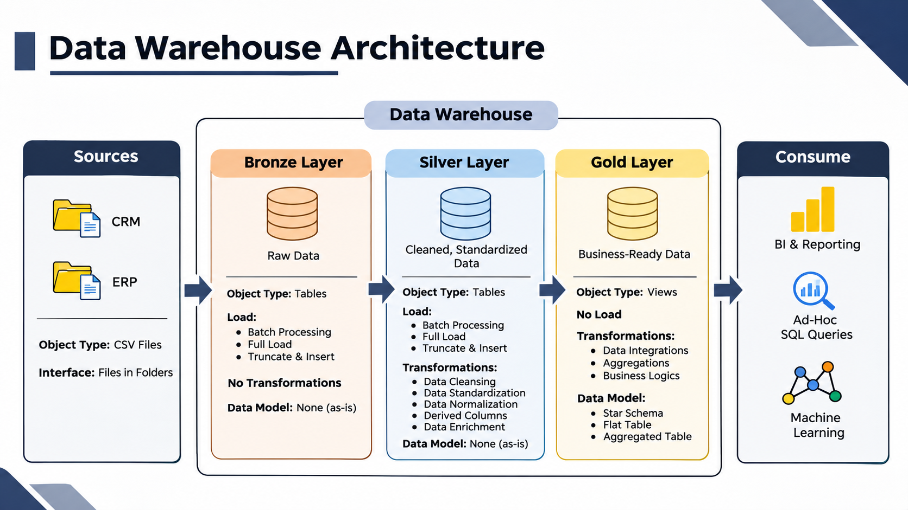
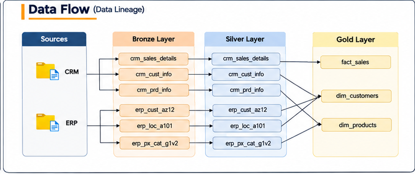
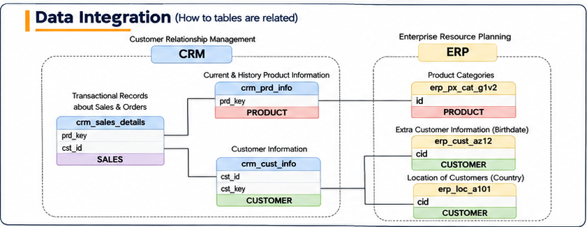
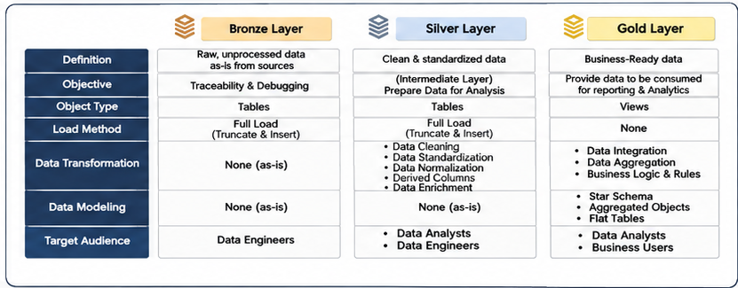
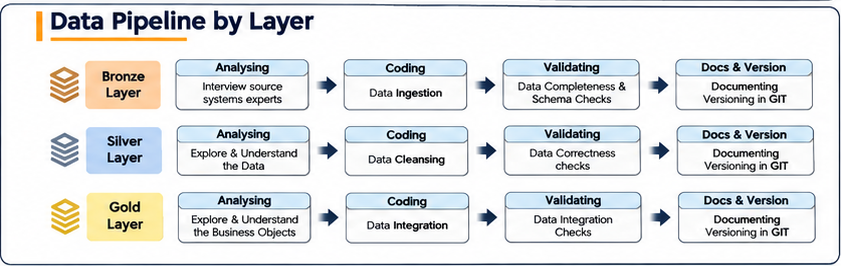
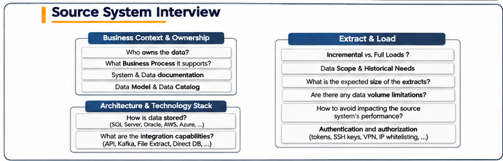

# Sales Data Warehouse | SQL Server

A modern SQL Server Data Warehouse built using the **Medallion Architecture (Bronze, Silver, and Gold)**. This project integrates CRM and ERP data from CSV source files, implements ETL pipelines, performs data cleansing and transformation, and organizes the resulting data into structured, business-ready datasets.

**Project Category:** Data Engineering  
**Database:** Microsoft SQL Server  
**Architecture:** Medallion Architecture  
**Data Modeling:** Star Schema

---

## 1. Project Overview

The objective of this project is to develop a centralized data warehouse that consolidates sales data from two source systems: Customer Relationship Management (CRM) and Enterprise Resource Planning (ERP).

The data is processed through three layers to ensure data quality, consistency, integration, and usability for analytical purposes.

## 2. Data Warehouse Architecture

The project follows the Medallion Architecture, consisting of three layers:



| Layer | Description |
|---|---|
| Bronze | Stores raw data from CRM and ERP source files without transformations. |
| Silver | Cleans, standardizes, normalizes, and enriches the raw data. |
| Gold | Organizes transformed data into business-ready views using dimensional modeling. |

## 3. Data Sources

The project uses six CSV files from two source systems.

**CRM (Customer Relationship Management)**
- Customer information
- Product information
- Sales transaction details

**ERP (Enterprise Resource Planning)**
- Additional customer information
- Customer location information
- Product category information

## 4. Data Flow (Data Lineage)

The data lineage illustrates how source data moves through the Bronze, Silver, and Gold layers.



## 5. Data Integration

CRM and ERP datasets are integrated to create a consistent data structure. Relationships between customer, product, and sales records are established using their corresponding keys.



## 6. Medallion Architecture Overview

Each layer has a specific responsibility in the data processing workflow.



- **Bronze:** Raw data ingestion and storage.
- **Silver:** Data cleansing, standardization, normalization, and enrichment.
- **Gold:** Data integration, business logic, aggregation, and dimensional modeling.

## 7. Data Pipeline Process

The development process for each layer involves analyzing, coding, validating, and documenting the data.



## 8. Source System Requirements

Source system requirements cover business context, data ownership, architecture, technology, extraction, and loading considerations.



## 9. Data Engineering Implementation

The project covers the following implementation activities:

- Designed the Data Warehouse architecture.
- Loaded raw CSV datasets into SQL Server.
- Developed Bronze Layer ingestion procedures.
- Implemented Silver Layer data cleansing and transformation.
- Integrated CRM and ERP datasets.
- Developed Gold Layer dimensional models.
- Created fact and dimension views using a Star Schema.
- Performed data quality validation.

## 10. Technologies Used

| Technology | Purpose |
|---|---|
| Microsoft SQL Server | Data warehouse database |
| SQL / T-SQL | Data ingestion and transformation |
| SQL Server Management Studio (SSMS) | Database management |
| CSV | Source datasets |
| Draw.io | Architecture and data modeling diagrams |
| Git & GitHub | Version control and documentation |

## 11. Repository Structure

```text
sql_data_warehouse/
│
├── datasets/
│   ├── source_crm/
│   └── source_erp/
│
├── docs/
│   ├── 02-data-flow-lineage.png
│   ├── 03-data-integration.png
│   ├── 04-bronze-silver-gold-overview.png
│   ├── 05-data-pipeline-by-layer.png
│   ├── 06-source-system-interview.png
│   ├── 07-data-warehouse-architecture.png
│   └── naming_conventions.md
│
├── scripts/
│   ├── init_database.sql
│   ├── bronze/
│   ├── silver/
│   └── gold/
│
└── test/
    ├── quality_checks_silver.sql
    └── quality_checks_gold.sql
```

## 12. Project Scope

**Completed: Data Warehouse Development**

This implementation focuses on the Data Engineering component of the original project, including data ingestion, ETL development, data transformation, data integration, data quality validation, and dimensional modeling.

The separate business analytics and reporting component is not included in this implementation.

## 13. Acknowledgment

This project was developed as a hands-on learning experience using educational materials and guidance from the original SQL Data Warehouse Project by **Data With Baraa**.

Original Repository: https://github.com/DataWithBaraa/sql-data-warehouse-project

Credit for the original educational materials and resources belongs to their respective author.

---

**Data Engineering | SQL Server | ETL | Data Warehousing | Medallion Architecture**
